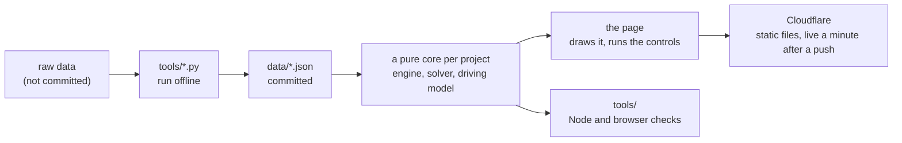

# patrick-site

The source of [pmcdonough.com](https://pmcdonough.com): interactive models and side projects that run entirely in the browser. Everything is static: plain HTML, CSS and JavaScript modules served from `public/`, no framework, no build step, no server code. Nearly all of the code was written by Claude, directed, reviewed and tested by the owner (`docs/PROCESS.md`).

## The projects

| Project | Where | What it is | Doc |
|---|---|---|---|
| **Hockey Strategy Lab** | `public/bruins-vs-canadiens/` | A 5-on-5 hockey engine with real 2025-26 Bruins and Canadiens rosters, an expected-goal model fit on 237,055 NHL shots and goalies' real save rates. Watch a game, review every shot by the shooter's own read, and test game plans over 100 seeded games in the Game plan lab | `docs/HOCKEY-LAB.md` |
| **Play Review** | `public/play-review/` | The first prototype of the shot review: a real game (Montreal 3 at Boston 4, January 24, 2026) scored shot by shot with the sim's own model | `docs/PLAY-REVIEW.md` |
| **Cathedral Lab** | `public/cathedral-lab/` | Notre-Dame and Amiens built stone by stone in 3D, every stone carrying real load from a rigid-block masonry solver; an arch lab, and a page to design your own and see whether it stands | `docs/CATHEDRAL-LAB.md` |
| **Ring Kart** | `public/ring-kart/` | A kart-style race round the Nürburgring Nordschleife in real cars, from the Touristenfahrten gate to the gantry | `docs/RING-KART.md` |

Each project has its own version, shown on its home page card and in its footer. The site has one too, in the home page footer. `CHANGELOG.md` has every version.

## Run it

```
git clone https://github.com/pmcdonough/patrick-site.git && cd patrick-site
node tools/serve.js                  # then open http://localhost:8000/
```

Any static server works (`python3 -m http.server --directory public 8000`). The pages fetch their data over HTTP, so opening them from disk does not work. To run the checks, install the tools once (`LOCAL-SETUP.md`), then:

```
node --test tools/test               # unit tests, "fail 0"
node tools/smoke.js                  # every page in headless Chromium, "ERRORS: []"
```

## How it is built



- **A pure core and a page around it.** Each project's logic (the hockey engine, the masonry solver, the driving model) never touches the page, so it runs in Node for tests and thousands of games at a time.
- **Data, not constants.** Every number someone might question is in a JSON file with a description and its source.
- **Deterministic.** A hockey game depends only on its seed and plays identically in Node, Chrome, Firefox and Safari, which makes strategy comparisons fair and lets the checks prove a change left 200 saved games exactly as they were.
- **Measured, not eyeballed.** Each change is checked against saved reference games and against the real 2025-26 teams, locally and on GitHub on every push.

`docs/ARCHITECTURE.md` has the whole picture, and `docs/DECISIONS.md` says why each choice was made.

## Documentation

`docs/README.md` is the full index, with reading paths for a visitor, a contributor and a modeler. The most useful:

| Doc | For |
|---|---|
| `docs/ARCHITECTURE.md` | how the site and each project are put together, the stack, versions, checks and deploys |
| `docs/DESIGN.md` | the look, the voice and the components, and the checklist for a new page |
| `docs/EXTENDING.md` | recipes: change a number, add a system, add a check, add a building or a car, add a project, ship |
| `docs/PROCESS.md` | how it was built and the working method |
| `docs/DECISIONS.md` | the decisions that shape the repo, with their reasons |
| `docs/ROADMAP.md` | where each project stands and what comes next |
| `LOCAL-SETUP.md` | one-time setup and every check |
| `CLAUDE.md` | the rules of the road and the shipping checklist; loaded by every Claude Code session |

## Repo map

```
public/                 the site, served as it is
  index.html            home page
  under-the-hood/       the architecture for visitors (the easter egg in the home page footer)
  bruins-vs-canadiens/  Hockey Strategy Lab: index.html, style.css, src/engine/ (the engine), src/ (the page), data/
  play-review/          Play Review
  cathedral-lab/        Cathedral Lab: the 3D build, arch-lab/, design/, src/vendor/ (Three.js r128)
  ring-kart/            Ring Kart
  keystone/             forwards to cathedral-lab/ (its old name)
tools/                  checks, the engine in Node, the data scripts, bump.js, serve.js
  test/                 unit tests (node --test tools/test)
docs/                   the documentation
.github/workflows/      checks.yml: the checks on every push
raw/, .venv/            raw inputs and the Python environment (git-ignored)
```

## Sources

MoneyPuck (2025-26 skaters, goalies, lines and teams; shot files for 2024-25 and 2025-26), NHL EDGE skating benchmarks, the NHL play-by-play and shift chart API, and Hockey-Reference 2025-26 statistics. Cathedral Lab's dimensions and Ring Kart's lap times are cited in their docs. `docs/RAW-INPUTS.md` lists every raw file with its URL and retrieval date. Raw data is not redistributed here; the scripts that turn it into the committed data files are.
