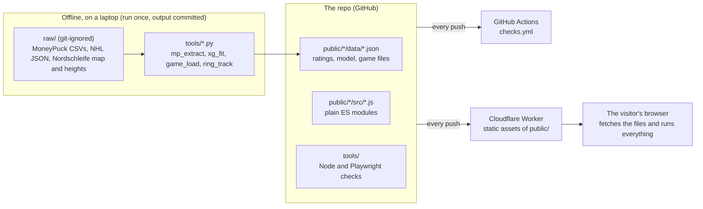
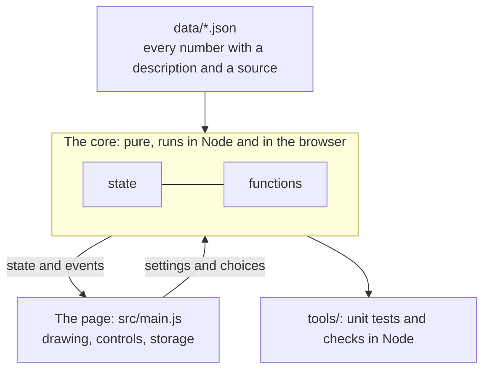
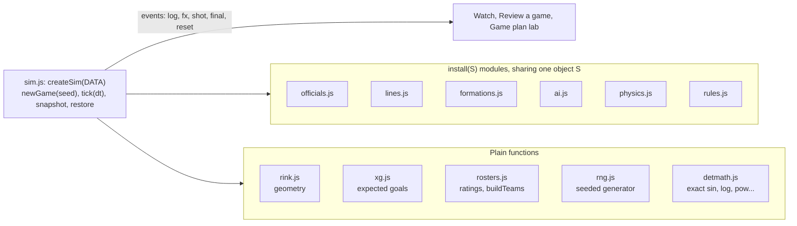
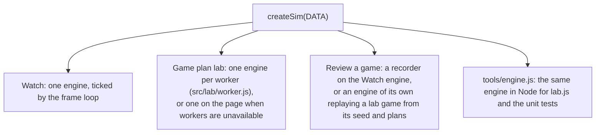
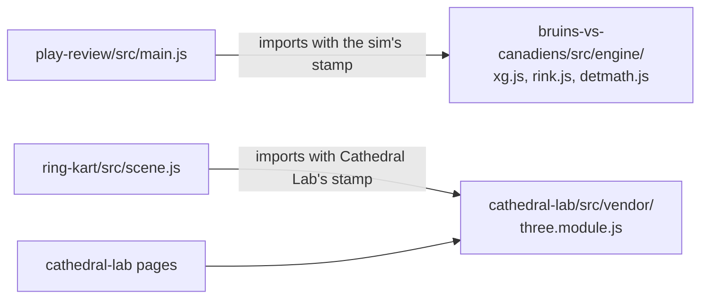
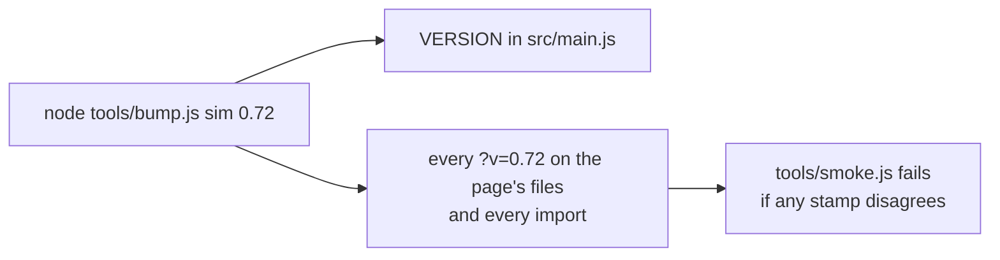

# Architecture

How the whole site is put together: what runs where, the one pattern every project follows, how the pieces share code, how a change gets from an editor to a visitor, and why it is built this way. Each project's own doc goes deeper (`docs/README.md` lists them). `public/under-the-hood/` tells the same story for visitors.

## The system in one picture

Three places, with a hard line between them:

1. **The browser runs everything a visitor sees.** The site is static files. No server code, no database, no accounts. Every computation (a hockey game, a masonry solve, a lap of the Nordschleife) runs on the visitor's machine. What a visitor keeps (lab results, a design, best laps) is in their own `localStorage`.
2. **Heavy tools run offline, once, and their output is committed as data.** Fitting the expected-goal model needs pandas and scikit-learn and 136 MB of shot files. None of that ships. The script, its compact JSON output and the list of exact inputs (`docs/RAW-INPUTS.md`) are in the repo, and each script reproduces its committed output byte for byte.
3. **Checks run in Node and in headless browsers**, locally before a push and again on GitHub after it (`.github/workflows/checks.yml`).

## The stack, and what was left out

| Layer | What it is | Left out on purpose |
|---|---|---|
| Markup and style | HTML and CSS, one stylesheet per project, light and dark themes from CSS custom properties | CSS frameworks, preprocessors |
| Code | JavaScript ES modules loaded straight by the browser | TypeScript, bundlers, transpilers, npm packages at runtime |
| Drawing | Canvas 2D (the hockey rink, the arch lab, Play Review); WebGL through Three.js r128 (Cathedral Lab, Ring Kart) | any other library |
| Parallelism | Web Workers (the Game plan lab plays games on every spare core) | |
| Browser APIs | `localStorage`, Web Audio (Ring Kart's engine note), Gamepad API, the print dialog | anything that needs a permission prompt |
| Hosting | A Cloudflare Worker serving `public/` as static assets, deployed from GitHub on every push | a build step, a server, a CDN for libraries |
| Data pipeline | Python 3 with pandas and scikit-learn in `.venv/` | |
| Checks | Node's own test runner, Playwright (Chromium, Firefox, WebKit), GitHub Actions | a test framework |

Three.js is the one library. It lives in `public/cathedral-lab/src/vendor/` and is served from the site with Cathedral Lab's version stamp; Ring Kart imports that same copy. Fonts come from Google Fonts (Barlow and Barlow Condensed for the projects, Inter for the home page, Under the hood and Play Review).

The reason for the short list is that every page has to keep working for years with nobody tending it. A page that is only static files, with no build and no dependency tree, cannot break because a package moved.

## The pattern every project follows: a pure core and a page around it

Every project is split the same way. A core of plain functions and state does the work and never touches the page: no `document`, no `window`, no drawing. The page creates the core, reads its state, listens to its events and draws. Because the core has no page in it, Node can run it, which is how the unit tests and balance checks work.

| Project | Its core (no page in it) | Its page |
|---|---|---|
| Hockey Strategy Lab | `src/engine/` (`createSim`), `src/lab/read.js` | `src/main.js`, `src/review.js`, `src/lab/worker.js` |
| Play Review | the sim's `xg.js`, `rink.js`, `detmath.js` | `src/main.js` (reconstruction, scoring and replay) |
| Cathedral Lab | four layers, each importing only those below: `src/solver.js` (masonry), `src/kit.js` (pieces, steps, loads), the builders and buildings (`gothic.js`, `design.js`, `notre-dame.js`, `amiens.js`, `yours.js`) | `src/main.js` (3D), `arch-lab/src/main.js`, `design/src/main.js` |
| Ring Kart | `src/track.js` (the road from the points `tools/ring_track.py` builds from OpenStreetMap), `src/drive.js` (arcade physics, the AI, the gearbox), `src/line.js` (the best line and the pro) | `src/scene.js` (the Three.js world and cars), `src/audio.js` (Web Audio), `src/main.js` (the session, input, camera, HUD) |

Cathedral Lab's layers, its piece data model and the contract a building module meets are in `docs/CATHEDRAL-LAB-CODE.md`; its refactors are proven by byte-identical piece fingerprints, the way the engine's are proven by game fingerprints. Ring Kart runs its physics in fixed 1/120 s substeps and draws from state only; its game is not seeded, since nothing replays it. `docs/RING-KART.md` is its full reference.

Each page also puts a small hook on `window` (`rinkSim`, `cathedralLab`, `archLab`, `ringKart`) that the browser checks use to drive it without clicking.

## The hockey engine

The biggest piece, about 1,600 lines in 12 modules under `public/bruins-vs-canadiens/src/engine/`. `docs/ENGINE.md` names the file for every function; this is the shape.

- **One shared object.** `createSim` builds the state and passes one object, `S`, to each module's `install(S)`. Each module adds its functions to `S` and returns a `link()` that picks up the other modules' functions once all are installed, so modules can call each other in any direction while each file stays about one subject.
- **All state hangs off four roots:** `teams`, `puck`, `game` and `officials`. No module keeps game state in its own variables. That is what makes `snapshot()` and `restore()` possible, and the shot review's What if he passed depends on it.
- **A tick** is 0.03 s of game time: clock and penalties, line changes, every skater's target, the carrier's decision, skating, the puck (saves, blocks, rebounds), then offside, icing and whistles. A game is over 120,000 ticks and plays in about two seconds when nothing is drawn.
- **Events out, never calls in.** The engine announces what happened (`log` for a play-by-play line, `fx` for a ring or a save flash, `shot` at every release, `final`, `reset`), and the page decides what to draw.

### One engine, three ways to play it

There is no second implementation of a game anywhere. The lab, the review and the Node tools all call the same `newGame(seed)` and `tick`. A seeded game plays identically in all of them, and the checks prove it.

### Determinism

The lab compares two plans by playing them through the same luck, and the checks say "every game finished exactly as before". Both need a game to be a pure function of its seed:

- `newGame(seed)` gives the game its own generator (`rng.js`). The engine never calls `Math.random`.
- `newGame` rebuilds both teams, the puck and the clock from scratch, so nothing carries over from the last game except the plans.
- The engine never calls `Math.sin`, `cos`, `atan2`, `exp`, `log`, `pow`, `hypot` or `**`. Browsers and Node are allowed to differ in the last bit of those, and that once changed how 2 games in 20 ended. `detmath.js` computes them from exact arithmetic.

`tools/lab.js --order` (reverse order in one process), `--pool` (the page's own workers) and `tools/browsers.js` (Chromium, Firefox, WebKit against Node) check it.

Cathedral Lab and Ring Kart replay no seeds, so they use `Math` freely.

## Shared code between projects

Code is shared by importing it across folders, never by copying.

The expected-goal formula exists once, so Play Review and the sim cannot disagree on a shot. Three.js exists once, so the site never loads two copies. `tools/bump.js` knows about both links: bumping the sim updates Play Review's imports from it, and bumping Cathedral Lab updates Ring Kart's Three.js import.

## Data as configuration

Every number someone might question lives in a project's `data/` folder with a `desc` that says what it means and where it came from: skating speeds, change windows, the save model's scale, a car's grip, a building's dimensions. The code reads them (`PH` and `SYS` in the engine). Changing a number is a data edit, and the checks show what it did. `docs/MODELING.md` sorts every hockey number into measured, calibrated or inferred, and keeps the three apart.

## Versions and caching

- The site has one version (the home page footer, the Site section of `CHANGELOG.md`). Each project has its own (`VERSION` in its `src/main.js`, its card badge on the home page). As of this writing: site 0.114, sim 0.71, Play Review 0.10, Cathedral Lab 0.15, Ring Kart 0.15.
- Every file a page loads, and every import inside it, carries `?v=` with its project's version. The Worker serves every file with `Cache-Control: public, max-age=0, must-revalidate`, so browsers check each file on every visit, and the stamps make sure a visitor never runs a new module against an old one during a deploy.
- Saved browser data carries its version where a version change would make it wrong. The lab's results (`rink.lab`) and recent lab games (`rink.reviews`) are dropped when the sim version changes, because the same seed may now play differently; plans and designs are kept.

## What the browser keeps

| Key | Project | What it holds |
|---|---|---|
| `rink.lab` | Hockey Strategy Lab | the lab's plans, baseline, tests, games count; results dropped on a new sim version |
| `rink.reviews` | Hockey Strategy Lab | recent lab games for Review a game, as seed and plans only |
| `rink.systems`, `rink.admin` | Hockey Strategy Lab | the Watch plans and slider settings saved as defaults |
| `rinkFx`, `rinkSticks`, `rinkSight` | Hockey Strategy Lab | the Watch toggles |
| `cathedral-lab.design` | Cathedral Lab | your own design (designs are also shared by link) |
| `ringkart.*` | Ring Kart | the chosen car and driving mode, sound, gas and line settings, the best time per car and mode (`ringkart.best.<car>` for Expert, `ringkart.best.<mode>.<car>`), the pro's time per car |

Nothing leaves the browser. There are no analytics or cookies.

## Checks

The checks are layered by cost, and each layer catches what the one under it cannot.

| Layer | What runs | Catches |
|---|---|---|
| Unit tests (`node --test tools/test`, about 25 s) | the engine, the lab's reading, the solver, Ring Kart's driving, all in Node | a seed that depends on what ran before, state left over, unseeded draws, a snapshot that does not restore, frozen play, math off by one unit in the last place, a solver that disagrees with the classical arch, a car that cannot finish the lap |
| Reference games (`node tools/lab.js`, `--nhl`) | 100 seeded games at each of two settings, 8 processes | any change to play: each game's fingerprint is saved in `tools/baselines.json` |
| Page checks (`smoke.js`, `calibration.js`, `review.js`) | every page in headless Chromium over HTTP | a script error, a data file that does not load, a version stamp that disagrees, a lab that does not run, a Play Review shot that scores differently |
| Agreement checks (`--order`, `--pool`, `browsers.js`) | the same games in reverse order, in the page's workers, in three browsers | determinism broken anywhere |
| Hockey benchmarks (`shifts.js`, `rules.js`, the lab's reality check) | shift lengths, offsides, icings and 28 per-team numbers against the NHL | the model drifting from the real game |

GitHub runs the unit tests, both reference levels, smoke, order and pool and Play Review's reference on every push. `CLAUDE.md` (Checks) says which to run for which change.

## Deploys

A push to `main` deploys. Cloudflare's Worker `patrick-site` serves `public/` as static assets, with `pmcdonough.com` as its custom domain; the live site updates about a minute later, and the home page footer shows the site version to confirm it. The Worker has no script and no bindings, and the repo has no Wrangler config: the assets directory is set in the Cloudflare dashboard. Old addresses are kept working with small forwarding pages (`/keystone/` forwards to `/cathedral-lab/`).

## Why it is built this way

The short version of `docs/DECISIONS.md`:

- **Static and serverless** so the site costs nothing to run and cannot go down for lack of upkeep.
- **No build step** so the code in the repo is exactly the code a visitor runs, and anyone can read it with View Source.
- **A pure core** so the interesting part can be tested and measured in Node, thousands of games at a time, without a browser.
- **Data, not constants** so a hockey person can question a number, find its source and change it without reading code.
- **Determinism** so a strategy comparison is fair and "nothing changed" can be proven, not hoped.
- **Measured, not eyeballed** so every balance change has a number before and after, and the references say when anything moved.
