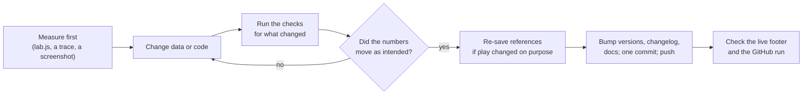

# Building on it

Recipes for the changes people most often want to make, each with the files to touch and the checks that prove it worked. Read `docs/ARCHITECTURE.md` first for the shape of things, and `CLAUDE.md` for the rules and the shipping checklist. Setup is in `LOCAL-SETUP.md`.

The loop for any change:



## Run it

```
node tools/serve.js            # serves public/ at http://localhost:8000/
node tools/smoke.js            # every page loads, a game plays, the stamps agree
```

Pages must be served; opened from disk they cannot fetch their data or modules.

## Hockey Strategy Lab

### Change a number

Every tunable number is in `public/bruins-vs-canadiens/data/` with a `desc`. Try it without editing the file first:

```
node tools/lab.js --nhl --param shotDecision.xgChoice.minXg=0.12                         # physics.json
node tools/lab.js --nhl --param systems.defensiveZone.zone.slotCoverage.maxFx=44           # systems.json
node tools/lab.js --param cfg.accel=1.5                                                  # a multiplier
node tools/lab.js --nhl --param a.b=1 --param c.d=2                                      # several at once
```

The report shows each club against the league and against the saved reference. If you keep it, edit the JSON, update its `desc` if what it means changed, and re-save the references (below).

### Add a new number to the engine

1. Put it in `physics.json` (or `systems.json`) next to the numbers it belongs with, with a `desc` in hockey terms that says what it does, its unit, and what it was set from.
2. Read it through `PH` (or `SYS`) in the module that needs it. Never write the number in code.
3. If it is calibrated, say what it was tuned to in the `desc` and record the before and after in `docs/ENGINE.md`.

### Add an option to a system

Say a fifth forecheck.

1. **Data.** Add it under its system in `systems.json` (`forecheck.<id>`): the spots in team-relative feet (`fx` from your own goal line 0 to 178, `fy` across 0 to 85), and a `desc` for visitors.
2. **The choices.** Add an `<option value="<id>">` to both teams' selects in the plan drawer in `index.html` (`hFore` and `aFore`). The lab and `tools/engine.js` read the options from those selects. The unit test "the plan drawer offers only choices the systems data defines" fails if the select and the data disagree.
3. **Behavior.** If the option is more than spots (a second chaser, say), put the flag in its data and read it where the decision is made (`ai.js` `assignTargets` for who chases, `formations.js` `formationSpot` for where people stand).
4. **Measure it.** `node tools/lab.js --nhl --sweep BOS.fore` plays every option on the same seeds and prints each against the current one with 95% intervals. An effect is real only when its interval excludes zero. Judge by expected-goal differential first; records need thousands of games.
5. **Explain it.** If it brings a new term, add it to `TERMS` in `src/main.js` so it gets a ? button and a glossary entry.

### Change how players behave

1. Find the function in `docs/ENGINE.md` (Where things live). Files are sectioned with `// ---------- Name ----------` comments.
2. Measure the problem first. Most engine work has started with a trace of the case (how often, from where, who was near) printed from a short Node script built on `tools/engine.js`, then a number before the fix.
3. Keep the invariants (`docs/ENGINE.md`, Invariants): state only on `teams`, `puck`, `game`, `officials`; every draw through `random()` or `rnd()`; no `Math.sin` and friends (add to `detmath.js` if needed); direction only through `toFx`, `toRink`, `zone` and `t.dir`.
4. Run `node --test tools/test`, then both reference levels. If anything moved and you meant it, write down what moved and why, and re-save.
5. Add a line to Lessons learned in `docs/ENGINE.md` if it fixed something that was wrong, so nobody brings it back. If you tried something that did not work, add it to the "ruled out" list in `docs/ROADMAP.md` with its number.

### Re-save the references

Only for a change you intended:

```
node tools/lab.js --nhl --save
node tools/lab.js --save
```

Then update `docs/ENGINE.md` (Baselines), the State section of `CLAUDE.md`, and say so in the commit. Saved lab results and recent lab games in visitors' browsers are dropped automatically on the new sim version.

### Add something the page shows

1. If the engine has to say something new, add an event (`emit('name', data)`) rather than letting the page read inside the engine's functions. The engine never touches the page.
2. Draw it in `src/main.js` (Watch, the lab) or `src/review.js` (Review a game). A new effect gets a toggle if it can be noisy.
3. Copy rules apply (`docs/DESIGN.md`): no internals, no em dashes, hockey words.
4. Run `node tools/smoke.js`; if it touches the lab, `node tools/calibration.js`.

### Add a check

- **A unit test** in `tools/test/<name>.test.js` with `node:test` and `node:assert/strict`. Engine tests build the engine with `tools/engine.js`. Pure page logic belongs in a module with no page in it (as `src/lab/read.js` is), so a test can import it.
- **A page check** in `tools/` with Playwright: start the server with `require('./serve').serve()`, load the page, wait on its `window` hook (`rinkSim`, `cathedralLab`, `archLab`, `ringKart`) and drive it through that.
- Add it to the Checks table in `CLAUDE.md`, to `LOCAL-SETUP.md`, and to `.github/workflows/checks.yml` if it is fast and needs only Chromium.

### Refresh the data for a new season

`docs/RAW-INPUTS.md` (Refreshing for a new season) has the files and commands. Re-run the scripts; never edit their outputs by hand. Then re-save the references, since every rating moves.

### Another real game for Play Review

`docs/RAW-INPUTS.md` (Another game for Play Review): download its play-by-play and shift chart into `raw/`, run `tools/game_load.py`, and point the page's `get('data/game-....json')` line at the new file. A game picker is on the roadmap.

## Cathedral Lab

`docs/CATHEDRAL-LAB-CODE.md` is Cathedral Lab's code reference: its layers, the piece data model, the contract a building module meets, the solver, kit, Gothic builder and design APIs, the 3D page's lifecycle, its invariants, and recipes for adding a building or changing the physics. In short: the solver is pure and checked in `tools/test/cathedral-lab.test.js` against classical results, a building is a module listed in `BUILDINGS` in `src/main.js` (`?b=<id>` opens it), and a refactor is proven by byte-identical piece fingerprints.

## Ring Kart

`docs/RING-KART.md` is Ring Kart's full reference, with its own recipes. The two most common:

### Add a car

Add it to `public/ring-kart/data/cars.json` with its real length, width, height and a body style, and arcade numbers in the right order against the others (top speed, acceleration, grip, braking, drift, mass), each described. `tools/test/ring-kart.test.js` drives every player car round the lap in Node; it must finish. If the body needs a new style, add a side view to `STYLE` in `src/scene.js`.

### Change the lap

`data/track.json` holds the hand-traced points with heights and named corners; `src/track.js` builds the road from them. The test above drives the whole lap.

## Add a new project

1. **Folder.** `public/<name>/` with `index.html`, `style.css`, `src/main.js` (with `const VERSION = '0.1';`), and `data/` if it has numbers. Start the stylesheet from an existing project's tokens and the light and dark pattern (`docs/DESIGN.md`).
2. **A pure core.** Put the logic in modules with no page in them, so Node can test it. The page creates the core, draws it and adds a `window.<name>` hook for the checks.
3. **Stamps.** Load `style.css` and `src/main.js` with `?v=0.1`, and every import inside `src/` with the same stamp.
4. **Tools.** Add the project to `tools/bump.js` (its key and folder), to `tools/smoke.js` (`checkStamps` and a load of the page), and a unit test in `tools/test/`.
5. **Home page.** A card in `public/index.html` with its version badge.
6. **Docs.** `docs/<NAME>.md` (what it is, how it is built, what is real, checks, roadmap), a section in `docs/ROADMAP.md`, a row in `README.md` and `docs/README.md`, the Layout and versions in `CLAUDE.md`, the summary line in `CHANGELOG.md`, and Under the hood if the stack changed.
7. **Ship** it as its own version: `CLAUDE.md`, Shipping a version.

## Ship it

The full checklist is in `CLAUDE.md` (Shipping a version). In short:

```
node tools/bump.js sim 0.72        # or review, cathedral, kart: VERSION and every ?v= stamp
# CHANGELOG.md: the section and the summary line; public/index.html: the badge and the footer's site version
# CLAUDE.md: the versions and State; docs/ROADMAP.md: its first line
node tools/smoke.js                # and the checks for what changed
git commit -m "What changed (sim 0.72, site 0.99)"
git push                           # live about a minute later; check the footer and the GitHub run
```

A change with nothing under `public/` (a tool, a doc) needs no version.
